# Entity relationship map

Source of truth: `prisma/schema.prisma` (Prisma 7, PostgreSQL, schemas `public` and `restricted`). Money is integer pence. Time columns are `timestamptz`.

## Core relationships

```mermaid
erDiagram
  Studio ||--o{ LegalEntity : has
  Studio ||--o{ Membership : has
  Studio ||--o{ Station : has
  Studio ||--o{ BookingRequest : receives
  Studio ||--o{ Appointment : hosts
  User ||--o{ Membership : holds
  User ||--o| ArtistProfile : "may be"
  User ||--o| ClientProfile : "may be"
  User ||--o{ BookingRequest : "client of"
  User ||--o{ Message : sends
  User ||--o{ Payment : pays
  User ||--o{ AuditLog : acts
  User ||--o{ Notification : receives
  User ||--o{ Signature : signs
  User ||--o{ ClientHealthRecord : "subject of"
  Membership ||--o{ CompensationModel : "effective-dated"
  ArtistProfile ||--o{ AvailabilityRule : works
  ArtistProfile ||--o{ Leave : takes
  ArtistProfile ||--o{ BookingRequest : assigned
  ArtistProfile ||--o{ Quote : issues
  ArtistProfile ||--o{ BookingHold : holds
  ArtistProfile ||--o{ Appointment : performs
  ArtistProfile ||--o{ PortfolioItem : publishes
  ArtistProfile ||--o{ ChairRentCharge : owes
  ArtistProfile ||--o{ CommissionEntry : earns
  ArtistProfile }o--o| Station : "default station"
  Station ||--o{ Appointment : used
  BookingRequest ||--o{ EnquiryStatusEvent : history
  BookingRequest ||--o| Conversation : has
  Conversation ||--o{ Message : contains
  BookingRequest ||--o{ Quote : versions
  BookingRequest ||--o{ ImageAsset : references
  BookingRequest ||--o{ BookingHold : reserves
  BookingRequest ||--o{ Appointment : "results in"
  Appointment ||--o{ Payment : receives
  Appointment ||--o{ FinancialLedgerEntry : posts
  Appointment ||--o{ ConsentResponse : requires
  Appointment ||--o{ GeneratedPDF : issues
  Appointment ||--o| Cancellation : "may have"
  Payment ||--o{ FinancialLedgerEntry : journals
  Payment ||--o{ Refund : "may have"
  WebhookEvent }o..o| Payment : confirms
  CompensationModel ||--o{ ChairRentCharge : bills
  CompensationModel ||--o{ CommissionEntry : splits
  ImageAsset ||--o{ ImagePermission : "opt-ins"
  ImageAsset ||--o{ PortfolioItem : shown
  DocumentTemplateVersion ||--o{ GeneratedPDF : rendered
  DocumentTemplateVersion ||--o{ ConsentTemplateVersion : "explains"
  GeneratedPDF ||--o{ DeliveryEvent : tracked
  ConsentTemplateVersion ||--o{ ConsentResponse : answered
  ConsentResponse ||--o{ Signature : signed
  ConsentResponse |o--o| ClientHealthRecord : "restricted link"
```

## All models by domain

| Domain | Model | Purpose |
|---|---|---|
| Tenancy and identity | Studio | The studio (name, trading name, timezone, currency). |
| | LegalEntity | Contracting parties: the studio's own entity and independent artists' businesses. |
| | User | Any person; Auth.js identity. Suspension flag. |
| | Account, Session, VerificationToken | Auth.js adapter tables (database sessions, magic-link tokens). |
| | DeviceLog | Sign-in/out and revocation events. |
| | Membership | A user's roles and capability overrides at the studio; status, MFA flag, access expiry, review date. |
| | CustomRole | Owner-defined roles with capability sets (schema only). |
| | Invitation | Tokenised role invitations (schema only). |
| Practitioners | ArtistProfile | Public profile, kind, styles, publication and enquiry flags, supervisor for apprentices, default station. |
| | PractitionerLicence, InsuranceRecord | Compliance evidence with verification and expiry. |
| | Station | Chair, room or station resource. |
| | AvailabilityRule | Weekly working windows in Europe/London minutes, optional validity range. |
| | Leave | Blocks of unavailability. |
| Clients | ClientProfile | Preferred name, DOB, phone, access needs, emergency contact. |
| | AgeVerification | Outcome of the in-person photographic ID check; no ID copies stored. |
| | PrivacyPreference | Un-bundled opt-ins per purpose, versioned, withdrawable. |
| Enquiry to booking | Service | Catalogue entry with duration, buffers, deposit, minimum age, piercing attributes. |
| | BookingRequest | The enquiry: structured brief, status, source, 18+ declaration, DOB. |
| | EnquiryStatusEvent | Human-readable status history. |
| | Conversation, Message | Private thread; messages are client-visible or internal-only. |
| | Quote | Versioned proposal with price basis, deposit, duration, sessions, terms snapshot. |
| | Project | Multi-session grouping (schema only). |
| | BookingReferenceCounter | Per-prefix, per-year counter for `RI-`, `ENQ-`, `INV-` references. |
| | BookingHold | 20-minute slot reservation while paying. |
| | Appointment | The booking with buffers, status, reference, deposit, hold expiry, no-show flag. |
| | Cancellation | Who cancelled, why, and the deposit outcome. |
| | Waitlist | Cancellation fill-in requests (schema only). |
| Media | ImageAsset | Stored object with visibility, scan status, photographer, rights holder. |
| | ImagePermission | Per-image opt-ins (publication, social, merchandise). |
| | PortfolioItem | Public gallery entry (healed/fresh, cover, order). |
| | FlashDesign, ArtworkRights | Flash sheets and their licence records (schema only). |
| | Review | Reviews with public/flagged moderation (schema only). |
| Payments and finance | Payment | A payment attempt: purpose, method, status, provider reference, manual verifier. |
| | PaymentAllocation | Allocation of a payment to an invoice. |
| | Refund | Approved refunds. |
| | WebhookEvent | Unique provider event log for idempotency. |
| | FinancialLedgerEntry | Append-only double-entry journal lines with reversal links. |
| | CompensationModel | Effective-dated arrangement (chair rent, commission split, custom, salaried, guest, apprentice, hybrid) with explicit eligible-base rules. |
| | ArtistContractVersion | Immutable signed agreement versions. |
| | Invoice, ChairRentCharge, CommissionEntry, Payout, Expense | Phase 3 billing and settlement (schema only). |
| Documents and consent | DocumentTemplateVersion | Versioned guide content with owner, approver, issue and review dates. |
| | GeneratedPDF, DeliveryEvent | Immutable rendered PDFs and their delivery audit. |
| | ConsentTemplateVersion | Versioned, legally reviewed consent schema (Phase 2). |
| | ConsentResponse, Signature | Per-appointment consent status, declarations, immutable signatures (Phase 2). |
| | ClientHealthRecord (restricted) | Encrypted health answers, escalation, retention date (Phase 2). |
| | HealthAccessLog (restricted) | Append-only log of every health record access (Phase 2). |
| | SessionLog | Operational session notes, dressing type and removal advice. |
| Inventory and hygiene | Supplier, Product, InventoryLot, StockMovement, SessionConsumable, PurchaseOrder | Stock, lots, expiry and session usage (Phase 3, schema only). |
| | Equipment, Maintenance, CleaningChecklist, Incident | Hygiene and incident records (Phase 3, schema only). |
| Recruitment and academy | ArtistApplication | Recruitment pipeline stages (Phase 3). |
| | TrainingModule, Enrolment, Assessment, MentorSignoff | Academy; only mentors create sign-offs (Phase 4). |
| Platform | StudioSetting | Editable business assumptions, audited. |
| | AuditLog | Actor, action, entity, before/after, reason, result. |
| | Notification | Every outbound message with delivery status. |
| | DevMailbox | Development-only outbox when no email provider is configured. |
| | MessageTemplate, IntegrationConnection, MarketingCampaign, AIActionApproval | Phase 4 (schema only). |

## Database-level invariants

Added in `prisma/migrations/20261021095556_init/migration.sql` beyond what Prisma generates:

- `btree_gist` extension.
- `appointment_artist_no_overlap`: `EXCLUDE USING gist (artistId WITH =, tstzrange(startsAt, endsAt, '[)') WITH &&)` for statuses `PENDING_DEPOSIT, CONFIRMED, CHECKED_IN, IN_SESSION`.
- `appointment_station_no_overlap`: same for `stationId` where not null.
- `appointment_ends_after_start` check.
- `hold_artist_no_overlap`: unconsumed holds cannot overlap per artist; expired holds are purged inside the advisory-locked transaction that creates a new hold.
- Immutability triggers (`prevent_ledger_mutation`) on `FinancialLedgerEntry`, `Signature`, `GeneratedPDF` and `restricted.HealthAccessLog`: UPDATE and DELETE raise.
- `BookingReferenceCounter` rows updated with `UPDATE … RETURNING` inside the booking transaction so references are unique under concurrency.
